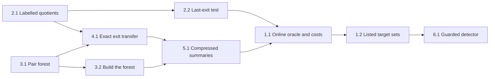

# Lean 4 formalization design for Paper B v1.2

The target is the ten-page article *Near-Linear Preprocessing for Reachability After Two Vertex Failures in Directed Acyclic Graphs*. The deposited source, PDF, and Figure 1 are pinned in the [source lock](sources/source-lock.json). There are nine proved paper statements and one open question. The two main Lean deliverables are the exact exit-transfer identity (4.1), followed by the resource-bounded online oracle (1.1). The scope ends with the two corollaries of this edition. [Published article](https://doi.org/10.5281/zenodo.24339761)

The executable milestones use the resource targets in the [v1.3 acceptance addendum](../evidence/paper-b-log-shave-20261118/formalization-v1.3.md). The same deterministic oracle must preprocess in O((n+m)L²) and answer in O(L), with O(n+m) peak construction words and O(n) retained words. The v1.2 requirements below remain the record for statement correspondence. The [archived v1.3 source](../submissions/paper-b-v1.3-20261118/paper-b-v1.3.md) has SHA-256 `86098c578c3297fc7952aa357bec9c0d80b9c6e854ce117622561cda7c276808`.

## What the two theorems must say

**Theorem 4.1.** Work in one labelled sibling quotient of the original graph. For every real forest edge with child pair P and parent pair B, every endpoint s of B, and every vertex y properly lost by P, the *original arc tails* usable from s to y at B are exactly the union of two sets. The first collects the tails usable to any endpoint of P outside B. The second collects the tails usable to y at P if s is shared, and is empty otherwise. The first set depends on the edge and s alone. Prove equality by tracking the same tail through both inclusions. Apply the result to the forest actually constructed in Lemma 3.1. A forest interface may expose the proved ancestry and topological-order properties. It must never assume the exit identity.

**Theorem 1.1.** Choose one deterministic construction and query program with uniform constants. For every explicitly represented finite adjacency-list DAG and original source, construct one index. For **every later** failure set of size at most two and original target, return true exactly when a surviving source-to-target path exists. A length-zero path requires a surviving vertex. Parallel arcs count individually. Encode its failures in zero, one or two ID slots. Two equal IDs denote one deletion. The query can inspect only its inputs and the retained index. With L the ceiling of log base two of n+2, prove four bounds on these same programs: construction time O((n+m)L³), peak construction words O(n+m), retained words O(n), and query time O(L³). Keep original input identifiers and initially unreachable vertices in the external specification.

## Proof order

| Paper item | Immediate mathematical inputs | What the proof must deliver |
|---|---|---|
| Lemma 2.1 | Paths, domination and topological order | Assign each retained arc once. Prove block entry and internal paths, projection, lifting of *specified* labelled arcs, flatness, and at most 2n quotient vertex copies. |
| Lemma 3.1 | A rooted DAG with flat dominator tree | Identify the first proper loss. Maintain one forest node per effective pair and a label for each vertex. Prove inclusive ancestry iff proper loss, stable parent on duplicate keys, nesting, order of fresh endpoints and linear node count. Can be proved for an abstract flat DAG. |
| Lemma 2.2 | Lemma 2.1, ordinary-tree LCA | Classify outside, LCA, own-block and third-block targets. Both endpoint exit sets are nonempty for a proper loss. A subtree contains all their tails exactly when it contains their original-tree LCA. |
| Theorem 4.1 | Lemmas 2.1 and 3.1 | Fresh suffix extension, shared-endpoint bypass, and the converse for a path visiting or missing fresh endpoints. Include disjoint pairs. Close the exact set identity. |
| Lemma 3.2 | Lemma 3.1 and growing-tree depth jumps | Realize the sweep and all local time, temporary-space, retained-space, key-lookup and known-node membership bounds. |
| Lemma 5.1 | Theorem 4.1 and Lemma 3.2 | Compress a set by LCA with an empty sentinel, compose two-coordinate maps, install maps before bases, and recover both summaries at every admissible ancestor. Establish the per-quotient bounds. |
| Theorem 1.1 | Lemmas 2.1, 2.2, 3.2 and 5.1 | Connect the programs on raw input, sum construction costs, bound live and retained storage, then apply the full query case split. Its manuscript proof is in Section 5. |
| Corollary 1.2 | Theorem 1.1 | Produce one Boolean per original list in order, including empty and repeated lists. Charge input, q outputs and all M target occurrences. Total O(SL³) time and O(S) words for S=n+m+q+M. A later list takes O((1+length)L³). |
| Corollary 6.1 | Corollary 1.2 and guarded-path semantics | For one supplied healthy-zero output and residual multiplicity at most two, decide detection and recover Q ∪ {i}. Charge every declared label, guard incidence and terminal, in O(Gdec log³(Gdec+2)) time and O(Gdec) words. |

Question 6.2 asks about three or more failures and has no formalization task.

## Milestones and first deliveries

| Milestone | Work packages | Exit criterion |
|---|---|---|
| EX0. Contracts and reuse | .1 bind the deposit and statement locations, .2 elaborate the two public types and replay reusable declarations on the chosen pin, .3 fix the word and memory model | A reviewer can read off the quantifiers, permitted inputs and all units. Only .1 is complete at planning time. |
| EX1. Graphs, dominators and last exits | .1 normalize IDs, reachability and orientation, .2 prove semantic dominator-tree facts, .3 build the labelled quotients mathematically, .4 prove the last-exit test, .5 construct a costed dominator tree, .6 implement interval, child and heavy-path LCA operations | Lemmas 2.1 and 2.2 have exact statements. The semantic and computational uses of the tree have distinct owners or interfaces. |
| EX2. Pair forest | .1 first proper loss, .2 inductive forest and key reuse, .3 growing-tree level ancestor, .4 costed construction and lookup | Lemma 3.1 is available for the structural proof. Lemma 3.2 adds the executable data structure and its own local bounds. |
| EX3. Exit transfer | .1 fresh endpoints, .2 inherited term and reverse inclusion, .3 assemble, check Figure 1 and replay the public theorem | **First main theorem**: exact equality for every child, endpoint and proper-loss target. The structural module can build independently of the word machine and oracle. |
| EX4. Compressed index | .1 empty/LCA join and map algebra, .2 chronological base construction, .3 jumps, lookup and local resource proof, .4 complete online query | Lemma 5.1 and functional correctness of the actual online function. Both endpoint coordinates survive reordering. |
| EX5. Resource theorem and batch | .1 sum charged operations, .2 account for live allocations and final layout, .3 bound the isolated query program, .4 assemble and audit the oracle, .5 aggregate lists | **Second main theorem**: the same implementation achieves all four bounds. Close Corollary 1.2 separately. |
| EX6. Guarded application | .1 adapt the healthy-zero path/shrinking lemmas to supplied Q, .2 build the query lists, return a witness and bound the full reduction | Corollary 6.1 covers both choices of Q, repeated labels and a deleted root. |

The [task ledger](TASKS.md) gives each package its module, prerequisites, consumer, acceptance checks and review roles. The [module graph](module-graph.json) distinguishes the pure forest and exit proofs from forest construction, costed dominator construction, static tree indexing, and the two downstream modules. The verifier reports structural, oracle and downstream progress separately. [Dashboard](DASHBOARD.md)

## Implementation choices to resolve at the start

1. **Graph adapter.** Reuse the local decreasing-index failure DAG through a topological renumbering of arbitrary input IDs. Preserve a list entry or arc ID for each physical incidence. A propositional child membership suffices for Boolean reachability. Lifting a specified sequence of quotient arcs needs the chosen incidence and its original tail. The proof uses the original dominator tree, the local quotient, and the pair forest as three different types.
2. **Dominator constructor.** Attempt a scoped replay of a matching constructor if available. The paper uses Lengauer–Tarjan. A DAG-specific alternative to evaluate uses the predecessor intersection characterization: when processing a reachable nonroot vertex in topological order, its immediate dominator is the LCA of its already inserted predecessors. Prove this from the last arc of a path. A candidate linear-space implementation folds LCAs over predecessor occurrences. Binary search on common ancestor depth uses O(L) tests of two level-ancestor queries, each budgeted at O(L²) by EX2.3. With one parent and jump per inserted node, this targets O((n+m)L³) total and linear space, sufficient for 1.1. This is a planned implementation alternative. Section 2's faster O((n+m)L) dominator subroutine needs its own proof if claimed. Either constructor must feed the same proved static tree interface.
3. **Word operations and lifetimes.** Examine the existing finite-word machine first. It accounts for heap, stack and output. Decide which operations directly realize comparison, lowbit and binary search under the paper’s word convention. Supply costed implementations or use a small, explicitly specified standard word model and prove the bridge for reused components. Uniform constants, word fit and addresses are obligations. Sort distinct predecessors per head and at most n candidate keys, keeping the original arc rows. Sorting all parallel incidences by comparison could introduce a log m factor beyond the claimed log n.
4. **Space and query independence.** Charge peak simultaneous arrays and temporary stacks on the construction trace. Serialize the index into named word arrays and prove its size after dropping adjacency, quotient arcs and predecessor lists. The query signature accepts only this data, the failure IDs and the target. Proof-only witnesses are erased. Count repeated scans in the forest. Charge at most one map traversal per incoming arc in the summary sweep, plus at most two fresh-endpoint traversals and one jump traversal per new pair.

## Controls and handoff

| Place | Control and expected observation |
|---|---|
| Graph and Section 2 | One vertex gives a surviving empty path until its source fails. Discarded targets stay unreachable. Comparable failures reduce to the higher failure. Parallel exits with different physical tails remain distinguishable. |
| Forest | Direct root arcs, duplicate predecessor occurrences, repeated pair keys and disjoint real pairs exercise separate branches. A directed cycle from Section 6 is outside the DAG input type. |
| Theorem 4.1 | In Figure 1 the U-coordinate has fresh contribution {ℓ} and inherited contribution {h}. For target y, failures {h,V} and {ℓ,V} each preserve a different route. Failures {U,V} remove both. Check the underlying sets as well as the three Booleans. |
| Oracle and corollaries | Exercise a missing key, an existing key off the target's forest path, reversed failure order, deep jumps, empty target lists, shared or repeated targets, and deletion of the decoder root by Q. Compare used identifiers and outputs entry by entry. |

The archived finite checks supply fixtures. Each milestone closes through a pinned declaration and fresh build, proof-dependency and axiom audit, and a comparison of the elaborated type to the deposited statement. For time and space attach the costed program and its layout. A historical build is reuse evidence. A finite replay exercises a case. The [handoff instructions](DISPATCH.md) specify what a worker records when a theorem is ready for independent review.
