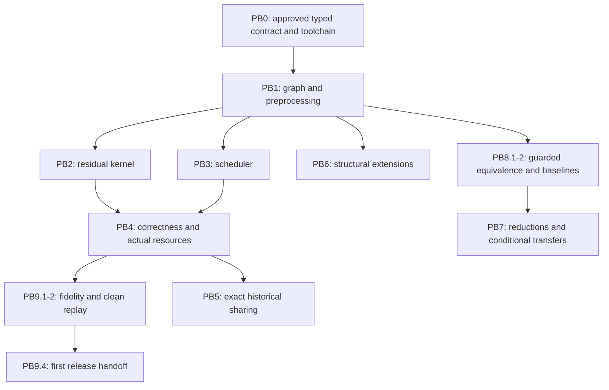

# Formalization architecture and execution plan

## Objective and acceptance unit

Verify the active Paper B v1.1 draft statement by statement while keeping the first release small enough to inspect. The primary acceptance unit is a **selected theorem with its literal hypotheses and resource claims**, not a completed helper file. The full paper inventory is 31 proof-bearing statements plus Question 6.2; [coverage.json](coverage.json) pins each statement and its statement-plus-proof block.

The principal first root is Theorem 3.2:

\[
\widetilde O(S+E\tau+(V+E)q_b/\tau)\text{ time},\qquad
\widetilde O(S+V\tau)\text{ working words},
\]

for one Boolean per original query on an explicit DAG with at most two failed vertices per listed query. All preprocessing, kernel discovery, original target incidences, and edge scans are included. The first root requires the full answer vector; an existential OR alone is insufficient. Individual-target tables and witness paths for every query are not required.

The follow-on root is Proposition 3.3: deterministic exact interning preserves that time bound and uses `Õ(S+Λ)` words, where `Λ` includes every distinct historical retained set. No universal near-linear bound on `Λ` is promised.

## Project structure

```text
paper-b-formalization/
  README.md, PLAN.md, INTERFACES.md, DISPATCH.md
  contracts/release-contract.md       proposed scope, then approved typed contract
  tasks.json                         one task ledger and explicit dependency DAG
  obligations.json                   selected-root obligation burn-down
  coverage.json                      exact 32-item active-v1.1-draft inventory
  reuse-audit.json, REUSE.md          provenance and reuse limits
  external-inputs.json                required library/literature/model inputs
  sources/                           pinned paper and authority records
  evidence/                          validation now; later actual proof evidence
  plan.py                            project-local validation and generated views
  release-core/                      proposed; no Lean files created yet
    Challenge.lean, Solution.lean, Audit.lean, comparator.json
    PaperB/{Spec,Normalize,Dominators,Primitives,SplitNetwork,
            BoundedFlow,PathRanks,Kernel,Scheduler,CostModel,
            Amortization,Resources}.lean
    PaperB/Interning.lean             admitted only for the later 3.3 root
  research/                          optional extensions, including Width/WeightedCover
```

The future core is **PALOMAR-FIRST**: approve its exact typed surface before theorem proofs, then admit only modules consumed by the selected roots. The broad optional research workspace is **RESEARCH-FIRST**. Existing controller code is an extraction source; it is not copied wholesale into a new core. These directories are proposals, not initialized repositories or compiled modules.

## Delivery order

Milestone identifiers group related obligations; they are not a requirement to finish every task in PB6 before starting PB7. Follow the task dependency graph. In particular, **PB4.1 supplies the operational model early**, before resource-sensitive normalization and primitives; the rest of PB4 closes their aggregate bounds. [module-graph.json](module-graph.json) separately records the proposed acyclic Lean imports; task dependencies include review and integration gates as well.

1. **PB0 — Scope and environment.** Verify source/reuse identities; review this architecture; choose a supported exact Lean/Mathlib pair; elaborate the actual Challenge and computational model; obtain approval of that precise contract. The current two completed items are planning audits only.
2. **PB1 — Semantics and preprocessing.** Define failure reachability and all degenerate cases; normalize explicit inputs; build dominator and incidence indices with charged construction. This is the shared foundation.
3. **PB2 — Residual kernel.** Verify split-network capacities, at most three augmentations, two-path decomposition, residual SCC/rank propagation, proper-cut testing and arbitrary-target membership. Correctness and construction cost join at PB2.7.
4. **PB3 — Scheduler.** Verify reverse-topological propagation, surviving-suffix invariants, retirement, and every-query soundness/completeness, including positive retirement and final-active negatives. It may initially use the agreed kernel interface; the final root must discharge it.
5. **PB4 — Full Theorem 3.2.** Connect the implemented program to the event accounting, bound stale as well as live edge pulls, charge every original target once through retirement, prove peak workspace and word bounds, then join the theorem on the original input. This is the first substantive mathematical milestone.
6. **PB5 — Exact sharing.** Add deterministic immutable-set interning and prove Proposition 3.3. Verify the two representation examples separately; they are not Boolean decision lower bounds.
7. **PB6 — Structural algorithms.** Common-anchor recognition; exact linear one-occurrence case; independent-tree localization and depth bound; streamed reachability chains and Hamiltonian specialization; constructed-width and weighted-cover consequences. Keep their different assumptions and answer contracts visible.
8. **PB7 — Reductions and conditional complexity.** Verify explicit constructions and sizes first. Only then compose them under precisely stated source hypotheses and an appropriate algorithm model. Deterministic word-RAM, algebraic and combinatorial assumptions are not interchangeable.
9. **PB8 — Remaining interfaces.** Guarded decoder equivalence, dual-Horn/bitset/algebraic baselines, canonical summaries, selector capacity/Kraft, Hitting Set, and the pinned physical/native application. These branches do not block the first graph-only theorem.
10. **PB9 — Fidelity and handoff.** Audit each chosen statement against its literal paper text, replay from a clean supported environment, compare Challenge/Solution and independent kernels, check the strict dependency cone, and prepare a user-controlled release packet. Theorem 3.2 may pass this gate before whole-paper coverage is complete.

## Critical path and work that can be separated



Within a milestone, use the work packages as micro-checkpoints of one to three exported obligations. After interfaces stabilize, the kernel, scheduler and resource tracks can overlap. The scheduler must not assume a whole-query oracle that already solves its task; the resources track must be involved before a convenient but uncharged data structure becomes entrenched.

## Gates that prevent misleading progress

For each task record separately: mathematical statement; implementation/refinement; construction and execution cost where claimed; source and toolchain identity; trust/dependency audit; paper correspondence. A task can be **implemented** without being **verified**. A conditional lemma may close its own interface while leaving its consumer open.

`DONE_PLAN` is reserved for evidence collection and planning. `VERIFIED` requires fresh evidence matching exact sources and public declarations. Until then, helpers, old task statuses, successful compilation, and source-only annotations cannot count as a certified paper statement. `obligations.json` is the primary first-root burn-down; the 60 task count is a work inventory.

Every meaningful proof batch must close a named root obligation or narrow its exported theorem type. After two consecutive batches without either, return proof exploration to the research workspace or revise the architecture explicitly. Do not keep building an unused abstraction ladder.

## Highest-risk obligations and decision points

- **A real computational model (PB0.4/PB4.1).** An uninterpreted cost field, zero-cost evaluator, or input-specific hardcoded program makes a resource theorem vacuous. Freeze fixed-program quantifiers and actual primitive execution rules first. If a compact assessable statement cannot express the claim, resolve that before expanding proofs.
- **The residual kernel (PB2).** The residual network may be cyclic. Two paths may share protected vertices. Target membership must hold outside the anchor's ancestor cone. A local cut fact alone does not supply the required oracle.
- **Amortization (PB4).** Charge stale and duplicate historical labels, failed tests, all completed kernels, and all original targets. Peak live memory is different from cumulative allocations.
- **Exact linear versus logarithmic preprocessing (PB6).** Binary lifting suffices for soft-O first-release bounds. It does not discharge the exact `O(G)` one-occurrence theorem; that branch needs an actual linear dominator algorithm and proof.
- **Algorithm-model lower bounds (PB7).** A reduction correctness theorem alone does not establish a complexity exclusion. In particular, an uninterpreted `combinatorial` predicate does not formalize closure of the intended algorithm class.
- **External capacity theorem (PB8.5).** The anti-isolation/preserver input is substantial. Until proved or matched to a supported formal theorem, capacity and Kraft consequences remain conditional formal statements, even though the paper supplies the mathematical citation.
- **Published application (PB8.8).** Paper A's registered roots have different full source pins. Compare selected declarations, role annotations and native-size costs; do not import a moving `main` and assume equivalence.

These risks are formalization workloads, not findings that the paper's proofs are false. If a new mathematical gap is discovered, preserve the published source and open a separately reviewed amendment; do not silently weaken the encoded theorem.

## First execution packet

Review PB0.3, then execute PB0.5 and PB0.4 to produce one supported environment, a small elaborated Challenge, primitive-cost decisions, an approved typed contract and a library feasibility report. This is the next bounded deliverable. No full-paper translation, new graph research, or publication is needed for it.

## Explicit non-goals

The project does not solve arbitrary 3-SAT, P versus NP, Question 6.2, the same-time universal near-linear-space gap, or the remaining fixed-ratio all-algorithm exponent gap. It does not infer novelty from successful formalization. It does not change Paper A's coverage declarations or the published v1.0 Paper B manuscript. The active v1.1 draft has a separate source pin.
