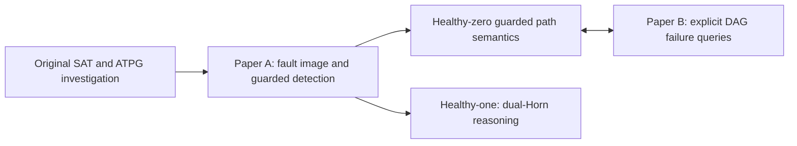

# Formalization plan for Paper B

This project plans formal verification of the [Paper B v1.1 draft](../papers/controller/paper-b-guarded-reachability-v1.1-draft.md), **Offline Reachability in Directed Acyclic Graphs under Vertex Failures**. The active draft has **32 numbered items: 31 proof-bearing statements and one open question**. Its preserved public baseline is [Zenodo v1.0, DOI 10.5281/zenodo.24142496](https://zenodo.org/records/24142496). Source identities and the distinct publication status are in [the source lock](sources/source-lock.json). No PDF of the active draft is asserted.

**Current state: planning complete; theorem implementation not started.** There are 60 dependency-linked work packages in ten milestones. Two source/reuse planning audits are complete; **zero new Paper B roots have been certified**. Existing Lean work is recorded as reuse evidence, not silently promoted to the published statements.

## Why this is a graph paper after starting with 3-SAT

The original SAT investigation identified circuit structure worth studying. Paper A establishes exact reachable fault images and a polynomial detection algorithm for a particular controller and guarded decoders. Paper B extracts the graph problem underlying that algorithm's **healthy-zero branch**.

A guarded decoder is true precisely when a path reaches a positive terminal and avoids the channel guards that would block it. After the forced-target deletion, a candidate label determines a failure set and a terminal set. Proposition 2.2 supplies the explicit reductions between this detection problem and offline sensitivity reachability. Thus Paper B studies an equivalent graph formulation of a **restricted branch**, with explicit input and sensitivity parameters.

This is a useful separation of concerns: Paper A explains the physical image and SAT encoding; Paper B analyzes graph algorithms and conditional lower bounds independently of circuit notation. The general 3-SAT problem is not reduced to the tractable two-failure regime by this argument. Allowing conjunctions of two computed decoder children leaves the guarded grammar and changes the complexity boundary.



## Start here

- [Plan and delivery order](PLAN.md): project structure, critical path, risks and stop rules.
- [Milestones](MILESTONES.md): ten exit gates with dependency-aware progress.
- [Task tracker](TASKS.md): all 60 work packages, prerequisites and acceptance criteria.
- [Coverage map](COVERAGE.md): every numbered statement linked to its formal obligations.
- [Interfaces](INTERFACES.md): exact mathematical boundaries between modules.
- [Proposed release contract](contracts/release-contract.md): selected roots, import boundary, ownership and size review thresholds.
- [Reuse audit](REUSE.md): existing Lean, historical builds and pinned Paper A registrations.
- [External inputs](EXTERNAL-INPUTS.md): which library and literature results still need formal discharge.
- [Work allocation](DISPATCH.md): proposed agent-sized assignments and coordination rules.

The editable records are [tasks.json](tasks.json), [coverage.json](coverage.json), and [obligations.json](obligations.json). The proposed Lean imports are recorded separately in [module-graph.json](module-graph.json). Markdown tracker views are generated from them; do not maintain a second status board by hand.

## First delivery and later coverage

The first substantive delivery is **Theorem 3.2**, including every original query's Boolean answer, actual deterministic implementation, total time, and peak workspace. It is not merely a reachability lemma or a solver with an assumed cost oracle. Proposition 3.3 is the next small release unit. Common-anchor, depth and chain algorithms, constructed-width and weighted-cover corollaries, reductions, and applications follow on separately tracked branches.

Question 6.2 stays open research. Formalizing the proved threshold tradeoff does not establish a near-linear unrestricted two-failure algorithm or a universal near-linear bound on historical-set storage.

## Tracker commands

Run from this directory:

```bash
python3 -B plan.py validate
python3 -B plan.py status
python3 -B plan.py ready
python3 -B plan.py show PB2.5
python3 -B plan.py render
```

`ready` means dependency-ready planning work. Proof work also requires the approved typed release contract and a pinned working environment. A successful plan validation checks source identities, coverage and bookkeeping; it proves no mathematical theorem.

The legacy `../formalization/` project and its 103-task board remain intact. This planning directory is not a Git repository or a proof release. The active plan tracks an unpublished draft. Published v1.0, registered source pins and the old 103-task proof board remain separate and intact.
