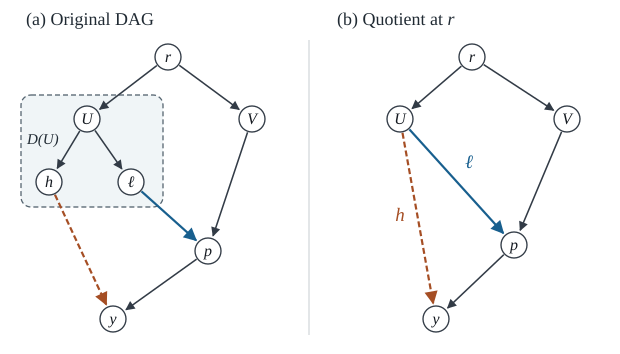

# Near-Linear Preprocessing for Reachability After Two Vertex Failures in Directed Acyclic Graphs

Idris Ali Shaik\
Independent researcher (unaffiliated)\
shaikidris@apache.org

**Version 1.3 (draft), 18 November 2026.**

## Abstract

Given a directed acyclic graph and a fixed source, we construct a linear-space index that decides whether a target remains reachable after the deletion of up to two vertices. The failures and target may be chosen after preprocessing. For \(n\) vertices and \(m\) arcs, the deterministic construction takes \(O((n+m)\log^2(n+2))\) time and \(O(n+m)\) working words. The index retains \(O(n)\) words and answers a query in \(O(\log(n+2))\) time. The construction groups vertices by their ordinary dominators. Inside each group, the pairs that disconnect other vertices are the nodes of a forest ordered by containment of the sets they disconnect beyond their endpoints. Our exit-transfer theorem expresses the exit tails at a parent cut as the union of a target-independent contribution from the child’s new endpoints and a contribution inherited at a shared endpoint. For each endpoint, the smallest and largest preorder ranks of its exit tails in the dominator tree suffice to test whether any tail survives. For an explicitly listed batch with a separate set of targets for each failure pair, the total time is near-linear in the graph and the lists, including preprocessing.

## 1. The oracle

For an initially reachable target \(t\), a single failed vertex \(a\) disconnects it from a source \(r\) precisely when every \(r\)-to-\(t\) path contains \(a\). For all initially reachable targets, the ordinary dominator tree stores this relation in linear space. Two failures can disconnect a target even when either failure alone leaves it reachable. Choudhary constructed a linear-space oracle for this second problem on general directed graphs. It answers each query in constant time after \(O(mn)\) preprocessing [Cho16, Cho17]. We ask how cheaply one can build an index when the graph is acyclic. This distinction matters already on a sparse graph, where preprocessing by the general bound can cost quadratic time before the first query.

Throughout, the input is an adjacency-list DAG \(G\) with a specified vertex \(r\). Write \(n=|V(G)|\), \(m=|E(G)|\) and \(L=\lceil\log_2(n+2)\rceil\). Parallel arcs are permitted and counted. Each query starts from \(G\) and names a set \(F\) of at most two vertices and an original target \(t\). Its answer is true precisely when \(G-F\) contains an \(r\)-to-\(t\) path. A path may have length zero. A failed source or target gives a false answer. Costs count deterministic word operations on an explicit input, with words large enough to address it and of logarithmic bit length. For a single target this is \(\Theta(\log(n+m+2))\) bits. For lists we use the explicit size in Corollary 1.2.

**Theorem 1.1 (two-failure reachability oracle).** Every such \(G,r\) admits a deterministic combinatorial index constructible in \(O((n+m)L^2)\) time and \(O(n+m)\) working words. The completed index occupies \(O(n)\) words. Given \(F\) and \(t\) after construction, it decides reachability in \(O(L)\) time using only the index and the query.

The construction keeps the tail of each arc that leaves a dominator subtree. This detail matters if a failure lies inside the subtree. Some exits can remain reachable while others are lost. For each endpoint block of a cut, consider the exit tails whose continuation reaches the target block while avoiding both endpoint blocks. One failed vertex disconnects a subtree, which occupies an interval in dominator-tree preorder. That interval contains every such tail exactly when it contains the first and last of them. Sections 2 and 3 identify the relevant cuts. The structural result, Theorem 4.1, expresses the parent cut’s exit tails using its child. Section 5 compresses these sets to prove Theorem 1.1.

**Corollary 1.2 (listed target sets).** Let \(q\) queries specify failure sets \(F_i\) with \(|F_i|\le 2\) and target lists \(T_i\). Put \(M=\sum_i|T_i|\) and \(S=n+m+q+M\). The Boolean vector whose entry \(i\) says whether at least one target in \(T_i\) survives can be computed in \(O((n+m)L^2+q+ML)\) total time and \(O(S)\) working words, including construction. A single list presented later takes \(O(1+|T_i|L)\) query time.

*Proof.* Construct the index once. For each list, test its targets under the supplied failures until one is reachable or the list is exhausted. An empty list takes constant time and returns false. Reading the failure sets and writing the answers costs \(O(q)\), and Theorem 1.1 charges \(O(L)\) for each of at most \(M\) target occurrences. The input lists, output vector and construction fit in \(O(S)\) words of \(\Theta(\log(S+2))\) bits. ∎

**Related work.** Theorem 1.1 trades query time for construction time on DAGs relative to Choudhary's general-digraph oracle [Cho16, Theorem 13; Cho17, Theorem 3.2]. Teslenko and Dubrova represent all double dominators of a given vertex in linear space and construct its representation in linear time [TD15]. In our path orientation that fixes the target. Teslenko describes the quadratic cost of building separate chain representations across all vertices [Tes08, §3.9]. Teslenko, Dubrova and Tenhunen report \(O(k\log n)\) time to combine the prepared dominator chains of \(k\) supplied circuit vertices [TDT06, §§5–6]. Here one index is built from the input DAG in \(O((n+m)L^2)\) time and retains \(O(n)\) words for any later target and failure pair.

The graph on siblings in the dominator tree is Tarjan's derived graph [GT15, §3]. For binary decision diagrams, Karplus represents two-cuts by child pairs linked to the next cut and gives a quadratic-time construction for that representation [Kar88, §§2.3–2.4]. We use the sibling graph with original arc tails, construct the cut forest for arbitrary indegrees in a DAG whose nonroot vertices all have the root as immediate dominator, and compose the exit information up that forest.

## 2. Where a surviving path can leave a block

Discard vertices unreachable from \(r\), retaining a translation for original identifiers. They can never become reachable through deletions. Also discard them from failure sets. On the retained graph, \(a\) *dominates* \(v\) if every \(r\)-to-\(v\) path contains \(a\). The dominators of \(v\) are its ancestors in a tree \(\mathcal D\) rooted at \(r\). Write \(D(a)\) for the subtree rooted at \(a\), including \(a\). Thus deleting \(a\) loses exactly \(D(a)\). We can find \(\mathcal D\) within \(O((n+m)L)\) time and linear working space by the simple Lengauer–Tarjan algorithm [LT79].

For a vertex \(d\) of \(\mathcal D\) with children, call each child subtree \(D(u)\) a *block* of \(d\). Define \(H_d\) to have root \(d\) and one vertex for each child. An original arc \(x\to y\) is assigned to \(d=\operatorname{idom}(y)\), the parent of \(y\) in \(\mathcal D\). If \(x=d\), insert \(d\to y\). Otherwise insert \(u\to y\), where \(u\) is the child above \(x\). In both cases label the inserted arc with its original tail \(x\). Two arcs with the same quotient endpoints may have different labels.

**Lemma 2.1 (sibling quotients).** Each \(H_d\) is a rooted DAG in which deleting any nonroot vertex loses only that vertex. Paths through the blocks project to paths in \(H_d\), and a quotient path lifts through any chosen sequence of its labelled arcs. Across all \(d\) there are at most \(2n\) vertex copies and one quotient arc per retained original arc.

*Proof.* Any arc into a strict descendant of \(u\) from outside \(D(u)\) would allow a source path to that descendant avoiding \(u\). Thus entry from outside a block is at its root. Every vertex of the block has an internal path from its root. Indeed, a source path to it passes through the root and could only reenter at that root, which acyclicity prevents. The same reasoning applies to \(D(d)\).

Every strict dominator of \(y\) dominates the tail \(x\) of an entering arc, since any source path to \(x\) extends to \(y\). The tail lies outside \(D(y)\), since otherwise \(y\) would precede \(x\), contradicting the arc \(x\to y\). The quotient arc is therefore well defined, and its tail precedes its head in original topological order. Project an original path segment starting at \(d\) and ending at a child of \(d\) by replacing each visit to a block by its root. Conversely, upon entering a block, follow an internal path to the original tail of the next specified arc. This lifts the quotient path, including the choice among parallel exits.

For distinct children \(u,y\), the vertex \(u\) does not dominate \(y\). A path to \(y\) avoiding \(u\) avoids its whole block. The suffix from \(d\) projects to a path avoiding \(u\) in \(H_d\). Hence every nonroot vertex there has immediate dominator \(d\). Each child occurs once as a child and at most once as a quotient root. Arc assignment uses the unique parent of its head. ∎

If the source fails, or if an original target was discarded, the answer is immediate. A single retained failure is handled by a dominator ancestry test. For two comparable failures the higher one suffices, since every source path visiting the lower one also visits the higher one. Suppose henceforth \(a,b\) are incomparable in \(\mathcal D\). Let \(d\) be their lowest common ancestor and \(u,v\) the distinct children of \(d\) above them. Write \(B=\{u,v\}\). For a pair \(B\) in \(H_d\), let \(Z(B)\) be all vertices lost on deleting \(B\), including \(B\), and let \(J(B)=Z(B)\setminus B\) be its *proper losses*.

For \(y\in J(B)\) and \(s\in B\), let \(X^B_s(y)\) be the set of original tails on quotient arcs \(s\to w\) such that \(w\) reaches \(y\) in \(H_d-B\). A direct arc to \(y\) qualifies. Both endpoint sets are nonempty. Deleting the other endpoint alone preserves \(y\), and the surviving path must visit \(s\). Its last exit from \(s\) supplies a tail. Number the vertices of the original dominator tree in preorder. The ranks in \(D(a)\) form the half-open interval \(I(a)=[\operatorname{tin}(a),\operatorname{tout}(a))\), where \(\operatorname{tout}(a)\) is the first rank after the subtree. For a nonempty set \(X\) of original vertices write
\[
 \sigma(X)=\bigl[\min_{x\in X}\operatorname{tin}(x),\,\max_{x\in X}\operatorname{tin}(x)\bigr],
 \qquad \sigma^B_s(y)=\sigma(X^B_s(y)).
\]
Set \(\sigma(\varnothing)=\varnothing\).

**Lemma 2.2 (last-exit test).** Every target outside \(D(d)\), and \(d\) itself, survives. A target in \(D(u)\) survives precisely when \(a\) does not dominate it, with the symmetric rule for \(D(v)\). For a target in a third block \(D(y)\), it survives if \(y\notin J(B)\). If \(y\in J(B)\), it survives precisely when
\[
 \sigma^B_u(y)\nsubseteq I(a)\quad\text{or}\quad \sigma^B_v(y)\nsubseteq I(b).
\]

*Proof.* Outside \(D(d)\) there is a path avoiding \(d\), so it avoids both failures. The two failures follow \(d\) in topological order. To reach a target in \(D(u)\) that \(a\) does not dominate, first reach \(u\) avoiding \(b\). This prefix avoids \(a\), a strict descendant of \(u\) in this case. Take the internal suffix of a path to the target avoiding \(a\). It avoids \(b\) because it stays in \(D(u)\). If \(a=u\), every target of this block is lost. The same argument applies in \(D(v)\).

A third block has no internal failure, so reaching \(y\) suffices. A quotient path avoiding \(B\) lifts by Lemma 2.1. Otherwise, consider a surviving physical path and its last exit from either of the two failure blocks. Its tail is reachable, and the remaining quotient path avoids \(B\). Conversely, any such reachable tail extends to \(y\) along the labelled arc and its continuation through failure-free blocks. The preceding within-block test determines which tails are reachable. For nonempty \(X\), all its tails lie in \(D(a)\) precisely when its smallest rank is at least \(\operatorname{tin}(a)\) and its largest rank is strictly below \(\operatorname{tout}(a)\). Applying these two comparisons at each endpoint gives the displayed test. ∎

## 3. A forest of separating pairs

Fix one sibling quotient \(H\) with root \(\rho\). Its dominator tree is flat, which means every nonroot vertex is a child of \(\rho\). We use \(B\) only for pairs of distinct nonroot vertices. Many pairs have no proper loss. Those with a proper loss can all be found in one topological sweep.

**Lemma 3.1 (forest of proper losses).** There is a rooted forest with one node for each pair \(B\) with \(J(B)\ne\varnothing\), and a label \(c(y)\) for each vertex of \(H\). Adjoin an artificial root \(0\) above all forest roots, allowing \(c(y)=0\). For every real pair \(B\), \(y\in J(B)\) precisely when \(B\) is an ancestor of \(c(y)\), with ancestry inclusive. A real child \(P\) of a real parent \(B\) satisfies \(P\subseteq Z(B)\) and \(J(P)\subseteq J(B)\). Every vertex in \(P\setminus B\) follows both endpoints of \(B\) in topological order. There are at most \(|V(H)|\) real forest nodes.

*Proof.* A proper loss of a pair follows both endpoints. Before its later endpoint, that deletion has no effect and the earlier endpoint alone loses only itself. Consider the first proper loss. Every predecessor is already lost, so each belongs to the pair. There must be two distinct predecessors, since a unique nonroot predecessor would by itself disconnect the vertex. Thus the two predecessors are precisely the failed pair. Each pair with a proper loss has such a first vertex, and the vertex determines the pair.

Now process \(H\) in topological order. At \(\rho\) and at vertices with an arc directly from \(\rho\), use label \(0\). Assume the statement about ancestor labels holds for earlier vertices. Every earlier real forest edge from \(B\) to \(P\) was installed with \(P\subseteq Z(B)\). This implies \(Z(P)\subseteq Z(B)\) even for future vertices. Indeed, a path surviving \(B\) cannot visit an unreachable vertex, so avoids \(P\).

At another vertex \(y\), let \(m_y\) be the latest distinct predecessor. A pair that properly loses \(y\) must lose all its predecessors. If that pair omits \(m_y\), it properly loses \(m_y\) and occurs on the ancestor path of \(c(m_y)\). On that path the real pairs losing every predecessor form a prefix starting nearest the artificial root, by the nesting of the \(Z\) sets. Let \(B_*\) be the deepest such pair, or \(0\) for an empty prefix. Conversely every real pair in this prefix properly loses \(y\), since its endpoints already precede \(m_y\).

If a pair contains \(m_y\), each other predecessor can be lost only by being its other endpoint. It precedes \(m_y\) and a singleton deletion disconnects only itself. Since \(y\) has no direct source arc, it has at least two distinct predecessors. The only additional pair is therefore \(P=\{p,m_y\}\) when these are exactly its predecessors. Install \(P\) immediately below \(B_*\), and set \(c(y)=P\). If this key already occurs, reuse the node. Its parent is determined by the labels and raw memberships at \(p,m_y\), fixed when those vertices were processed. If there is no additional pair, use \(c(y)=B_*\). Whenever \(B_*\) is real, both endpoints of the new pair belong to \(Z(B_*)\), as required for the induction. A pair first encountered at this step cannot acquire an earlier proper loss by the first-vertex argument.

The proper-loss sets are now inverse images under \(c\) of forest subtrees. This gives \(J(P)\subseteq J(B)\). A fresh endpoint in \(P\setminus B\) lies in \(Z(B)\setminus B\), so the initial topological observation places it after both old endpoints. ∎

**Lemma 3.2 (constructing the forest).** On a flat quotient with \(n_H\) vertices and \(m_H\) labelled arcs, the labels and pair forest can be built in \(O((n_H+m_H)L^2)\) time and \(O(n_H+m_H)\) working words. After construction, \(O(n_H)\) words suffice for pair lookup in \(O(L)\) time and, for a known pair node, proper-loss membership in \(O(1)\) time.

*Proof.* Give each distinct predecessor its topological number. For each head, a vertex-mark array indexed by predecessor gathers the distinct numbers in one scan of its incoming arcs. Sort only the distinct numbers. The original labelled arcs are still available for Section 5. Sort the candidate keys from vertices whose distinct predecessors are exactly two nonroot vertices, and locate a key by binary search. There are at most \(n_H\) such keys.

During the sweep we use Myers's skew-binary stack on the list of ancestors of each new leaf [Mye83, §§3–4]. Store each node's depth, its parent, and one jump \(j(v)\). Set \(j(0)=0\) at the artificial root. When a node \(v\) is appended to its parent \(p\), put \(a=j(p)\) and \(b=j(a)\). If the jumps from \(p\) to \(a\) and from \(a\) to \(b\) have the same positive length, set \(j(v)=b\). Otherwise set \(j(v)=p\). Length is the difference in depths, so insertion takes constant time.

To see the search bound, divide the list from \(v\) upwards, excluding the artificial root, into blocks of sizes \(2^k-1\) for \(k\ge1\). A singleton is one block. A larger block consists of its first node followed by two equal smaller blocks. The sizes increase from the front, with a tie allowed only between the first two blocks. The jump at the head skips the first block. Indeed, prepending a node either merges it with two equal leading blocks or adds a singleton. This proves the invariant by induction on insertion, including on different branches of the forest.

To reach a specified ancestor depth, take a jump whenever its endpoint has depth at least the requested depth. Otherwise take a parent step. Only \(O(L)\) whole blocks can precede the destination, since each size occurs at most twice. Within the block containing it, the parent step removes the first node, after which at most one of the two equal child blocks precedes it. The remaining block has less than half the previous size. Thus the traversal uses \(O(L)\) moves in total, including when the destination is the artificial root. Comparing depths and locating the ancestor at the shallower depth tests ancestry in the growing forest.

Use binary search on the path from the artificial root to \(c(m_y)\), including \(c(m_y)\), to find the deepest qualifying pair \(B_*\) in Lemma 3.1. At each of \(O(L)\) probes, locating the pair takes \(O(L)\) time. Scan the distinct predecessors. A predecessor is lost precisely when it is an endpoint or its label descends from the tested pair. The ancestry check takes \(O(L)\) per predecessor per probe. Summing over heads and incoming arcs gives \(O((n_H+m_H)L^2)\) time, including the repeated scans. After the sweep, preorder intervals in the finished forest decide proper-loss membership in constant time. Keep the intervals, sorted pair keys, vertex labels, depths, parents and jump pointers. ∎

## 4. Transferring exits between nested cuts

The forest tells us whether deleting two *whole* blocks loses a target. A physical failure can lie strictly inside either block, in which case some of its exits remain usable. The following identity computes exactly which original tails have to be tested. We use the notation \(X^B_s(y)\) of Section 2 in a fixed quotient \(H_d\).

**Theorem 4.1 (exit transfer).** Let \(P\) be a real child of a real pair \(B\) in the forest of \(H_d\). For each \(s\in B\) and \(y\in J(P)\),
\[
 X^B_s(y)
   = \bigcup_{p\in P\setminus B} X^B_s(p)
      \ \cup\
      \begin{cases}
        X^P_s(y), & s\in P,\\
        \varnothing, & s\notin P .
      \end{cases}
\]
The union over fresh endpoints is independent of \(y\).

*Proof.* Lemma 3.1 puts \(y\) and every fresh endpoint \(p\in P\setminus B\) in \(J(B)\), so all the sets on the left and in the union are defined. For each fresh \(p\), deletion of the other endpoint of \(P\) preserves \(y\). A surviving path must visit \(p\), since deleting both endpoints loses \(y\). Its suffix from \(p\) to \(y\) avoids the two earlier endpoints of \(B\). Appending the suffix to any exit witnessing \(X^B_s(p)\) proves that this tail belongs to \(X^B_s(y)\).

For the inherited term, write \(B=\{s,v\}\) and \(P=\{s,p\}\). Take an arc out of \(s\) whose continuation to \(y\) avoids \(P\). If that continuation visits \(v\), choose a source path to \(v\) avoiding \(s\), possible by flatness. The path also avoids \(p\), which follows \(v\). Concatenating this prefix with the continuation from \(v\) would reach \(y\) after deleting \(P\). Thus the continuation also avoids \(v\), and the original tail belongs to \(X^B_s(y)\).

Conversely, take an arc witnessing \(X^B_s(y)\). If its continuation visits a fresh endpoint \(p\), the prefix of that continuation to \(p\) places the tail in \(X^B_s(p)\). Otherwise the continuation avoids \(P\), since it already avoids all of \(B\). For \(s\in P\) this gives the inherited term. For \(s\notin P\), there exists a source path to \(s\) avoiding \(P\). Every fresh endpoint follows \(s\), and the at most one shared endpoint cannot by itself dominate \(s\). Concatenation with the chosen arc and continuation would survive \(P\), a contradiction. This also covers disjoint parent and child pairs. ∎

**A graph that needs both terms.** Take the seven vertices \(r,U,V,\ell,h,p,y\) and exactly the arcs in these three paths:
\[
 r\longrightarrow U\longrightarrow\ell\longrightarrow p\longrightarrow y,
 \qquad r\longrightarrow V\longrightarrow p,
 \qquad U\longrightarrow h\longrightarrow y .
\]
Figure 1 pairs the original DAG with its quotient \(H_r\). The arcs from \(U\) in the quotient carry their original tail labels.

{#fig-exit-transfer width=94%}

The block \(D(U)\) contains \(\ell\) and \(h\). In \(H_r\), the pair \(B=\{U,V\}\) properly loses \(p\) and \(y\). Its child \(P=\{U,p\}\) properly loses \(y\). For the shared endpoint \(U\), the first term of the identity contributes the physical tail \(\ell\) on the exit to \(p\). The inherited term contributes \(h\) on the direct exit to \(y\). Deleting \(h,V\) leaves the route through \(\ell\), whereas deleting \(\ell,V\) leaves the route through \(h\). Deleting \(U,V\) removes both. This is why storing only the separating pair, or keeping only one of the two terms, loses information about the original target.

## 5. Building and querying the index

Lemma 2.2 needs only the smallest and largest preorder ranks of the exit tails. For two nonempty intervals define
\[
  [l,h]\sqcup[l',h']=[\min(l,l'),\max(h,h')].
\]
The empty interval is the identity. Then \(\sigma(X\cup Y)=\sigma(X)\sqcup\sigma(Y)\), including when either set is empty. This associative operation takes constant time on rank pairs. We can therefore apply Theorem 4.1 directly to the summaries.

**Lemma 5.1 (compressed exit summaries).** Given the completed forest and its jump pointers in \(H_d\), the original-tree preorder ranks, and the labelled quotient arcs, one can build a base vector of two intervals for each vertex with a real label and two constant-size maps for each real pair node. For any \(y\in J(B)\) these records recover both intervals \(\sigma_s^B(y)\), \(s\in B\), in \(O(L)\) time. Building the records takes \(O((n_H+m_H)L)\) time and \(O(n_H+m_H)\) working words. They occupy \(O(n_H)\) words after construction.

*Proof.* Order the endpoints in each pair by topological number. For a real forest edge from child \(P\) to parent \(B\), form a map with two output coordinates. In coordinate \(s\in B\), its constant is the join of \(\sigma_s^B(p)\) over the fresh endpoints \(p\). If \(s\in P\), join that constant with the input coordinate for \(s\). Otherwise return the constant. Theorem 4.1 proves the map's effect for every target below \(P\). In particular its constants can be shared. Composing two maps of this form again gives two such coordinates. For a coordinate that copies an intermediate input, join the outer constant with the corresponding inner constant and retain the inner input slot if present. A coordinate with no input slot keeps its outer constant. Composition requires only a constant number of interval joins.

Process the vertices of \(H_d\) in topological order. Store at \(y\) the two summaries for its deepest pair \(c(y)\) when that pair is real. When a pair \(P\) first appears at such a vertex \(y\), install its map to its parent \(B\) *before* computing the base at \(y\). If \(B\) is real, each fresh endpoint \(p\) precedes \(y\) and lies in \(J(B)\). Its base at \(c(p)\) is already present. Every real pair on the path from \(c(p)\) up to \(B\) properly loses \(p\), so that pair first appeared no later than \(p\). Evaluating the maps along this path gives the constants needed for the new edge. A map to the artificial root may return two empty coordinates since no exit query asks for that root.

Now let \(B=c(y)\) be real. Inspect every entering arc \(z\to y\). If \(z=s\in B\), join the singleton interval of its original tail's preorder rank into coordinate \(s\). Otherwise \(z\in J(B)\), since an unfailed route to \(z\) would extend to \(y\) after deletion of \(B\). Evaluate the stored maps from \(c(z)\) to \(B\) on the base at \(z\), and join both coordinates into the base at \(y\). Every admissible exit is included by considering the last arc of its witnessing path. Every contribution extends to a witnessing path. The predecessor \(z\) is earlier than \(y\), so all these reads are available.

For each real node \(v\) store the map to its parent \(p\) and the map to its jump ancestor. If \(j(v)=p\), the maps coincide. In the merge case of Lemma 3.2, compose, in order of traversal, the edge map from \(v\) to \(p\), the jump map from \(p\) to \(a=j(p)\) and the jump map from \(a\) to \(j(a)\). The jumps start at proper ancestors of \(v\). Those pairs were already present when the sweep of Lemma 3.1 first encountered \(v\), so their maps are available in the same topological order. Thus installing the jump map takes constant time once the edge map is known. To evaluate a base at a specified ancestor, follow the jumps and parent steps of Lemma 3.2, applying one map at each move. This takes \(O(L)\) time.

Each entering arc requires at most one such evaluation, and each new pair needs at most two to obtain its fresh-endpoint constants. Initializing the bases and storing the maps takes constant time per record. Lemma 3.1 bounds the number of pair nodes by \(n_H\), giving the construction and space bounds. ∎

### Proof of Theorem 1.1

*Proof of Theorem 1.1.* Topologically order the graph and find its initially reachable vertices in \(O(n+m)\) time. Compute the dominator tree and its subtree intervals as in Section 2. For lowest common ancestors of the two failed vertices, at each nonleaf mark the edge to a child of maximum subtree size. The marked paths use \(O(n)\) words and take \(O(n)\) time to build. While the two vertices lie on different marked paths, replace the vertex whose path head is deeper by the parent of that head, breaking ties arbitrarily. On a common path, take the shallower vertex. Each unmarked edge crossed upward at least doubles the subtree size, so this takes \(O(L)\) time. Order each vertex's children by entry time. A binary search on these intervals identifies the child below a given strict ancestor in \(O(L)\) time, so all labelled quotient arcs can be formed in \(O((n+m)L)\) time. Construct each forest and its summaries by Lemmas 3.2 and 5.1. There are at most \(2n\) quotient vertex copies, and the quotient arc counts sum to at most \(m\). Although a predecessor list can be scanned during several forest tests, every such scan is charged within its own quotient's \(O((n_H+m_H)L^2)\) forest-construction budget. The summaries add \(O((n_H+m_H)L)\) per quotient. Summing gives \(O((n+m)L^2)\) time and \(O(n+m)\) peak working words.

For a query, translate its original vertex identifiers. Return false for a failed source or an initially unreachable target. Handle zero, one, or two comparable retained failures by an ordinary ancestry test as in Section 2. For two incomparable failures \(a,b\), find their LCA \(d\) and the children \(u,v\) above them. The outside and within-block cases of Lemma 2.2 use ancestry alone. In a third block with root \(y\), put \(u,v\) in increasing order of their stored topological numbers and look up the key \(\{u,v\}\). Use this same order to match the stored coordinates to the failures. If it is absent or its node is not an ancestor of \(c(y)\), the target survives. Otherwise apply Lemma 5.1 once and test the two coordinates in Lemma 2.2. The LCA, child lookups, pair lookup and map traversal each take \(O(L)\) time. The subtree comparisons take constant time. In particular a target equal to a failed vertex is lost by reflexive domination.

After construction discard adjacency lists, original arc labels, and temporary predecessor arrays. The original identifier map, topological numbers, dominator-tree data, interval arrays, pair lookups, vertex bases and forest maps together use \(O(n)\) words. The query procedure consults only these records. ∎

## 6. Guarded reachability and further failures

A guarded Boolean decoder supplies one application in which a list of targets is more natural than a single target. Its DAG has a root, sinks of constant value zero, labelled terminal sinks, OR gates, and guards. Any number of terminals may carry the same label \(i\), denoted \(h_i\). A guard has one child and a set of labels. For an input set \(K\), a terminal \(h_i\) is true if \(i\in K\), and a guard passes its child's value if its label set is disjoint from \(K\). Edges point from a gate to its children. Let \(G_{\mathrm{dec}}\) count the declared labels, vertices, arcs, guard memberships and output root.

The reference value is the output at \(\{t_0\}\), for a specified label \(t_0\). In the *healthy-zero* case this value is zero. A detecting set changes the output from its reference value, so here it makes the output one. Admissible test sets are nonempty and must contain a prescribed \(Q\), either \(\varnothing\) or \(\{t_0\}\). Delete once all guards meeting \(Q\), with their incident arcs. The *residual multiplicity* \(\mu\) is the maximum, over labels \(i\ne t_0\), of the number of remaining guards containing \(i\), with maximum zero for an empty candidate set.

**Corollary 6.1 (a guarded output of residual multiplicity two).** For one supplied healthy-zero guarded output with \(\mu\le2\), the existence of an admissible detecting set is decidable in \(O(G_{\mathrm{dec}}\log^2(G_{\mathrm{dec}}+2))\) time and \(O(G_{\mathrm{dec}})\) working words. A positive answer identifies an admissible detecting set.

*Proof.* A true output has a path to a true terminal on which every guard passes. To obtain the path choose a true child at each OR and follow the unique child of each true guard. Conversely any such path suffices. If \(K\) makes the output true by reaching \(h_i\), the same path is true on the subset \(Q\cup\{i\}\). The label \(i\) differs from \(t_0\), since a witnessing path ending at \(h_{t_0}\) would already be true on the reference singleton.

If the common deletion removes the root, detection is impossible. Otherwise use the surviving root as source in the residual DAG. For each \(i\ne t_0\), take the remaining guards containing \(i\) as the failed vertices, and take all terminals of label \(i\) as its target list. A positive list gives the test \(Q\cup\{i\}\). Each remaining guard membership and terminal is scanned once in building the lists, and the number of queries is at most the number of declared labels. Both \(n+m\) and \(q+M\) of the resulting batch are \(O(G_{\mathrm{dec}})\). Corollary 1.2 therefore gives the claimed time and space. ∎

For the drive-one first-stage bridge in a priority controller, the reachable-set theorem of [Sha26, Theorem 4.1] identifies \(Q=\{t_0\}\) for one request bus and \(Q=\varnothing\) for at least two. It also realizes an admissible detecting set by primary inputs. Corollary 6.1 concerns the decoder-level computation for a supplied healthy-zero output. Recovering circuit roles from an unannotated formula is a separate problem.

Acyclicity enters at the first proper loss in Lemma 3.1. To see what can fail on a directed cycle, take \(r\to a,r\to b,a\to x,b\to y,x\to y,y\to x\). The dominator tree is flat. Deleting \(a,b\) loses \(x,y\), although neither has precisely \(a,b\) as its distinct predecessors.

**Question 6.2 (higher sensitivity).** For arbitrary \(\mu\ge3\), can a deterministic combinatorial algorithm decide whether any listed target survives in any query on a DAG in \(\widetilde O(2^\mu S_\mu)\) total time, where \(S_\mu=n+m+q+\sum_i (|F_i|+|T_i|)\) and \(|F_i|\le\mu\)?

For zero failures a single search suffices. For one failure a dominator tree and its subtree intervals give a linear total bound with a linear-time dominator construction [BGK08]. Corollary 1.2 handles two failures at arbitrary depth and returns every list answer. For three failures, the proof that a vertex lost by the whole set follows all its endpoints breaks down if a smaller subset already disconnects it. The two-coordinate transfer also uses the fact that two distinct pairs have at most one shared endpoint.

## Computational checks

Two independent reachability calculations exercised the construction. On all 191,294 topologically ordered simple DAGs through seven vertices whose dominator tree is flat and whose first vertex is the source, explicit suffix-path enumeration gave 42,232 instances of the exit-set identity over nested pairs. All agreed as sets of exits. Both terms were indispensable in 20,052 of the tested coordinates. On all 1,099 ordered simple DAGs through five vertices, a topological deletion calculation agreed with the index for every choice of source, target, and failure set of size at most two, giving 421,402 comparisons. On 21 graphs with expanded blocks, explicit tail enumeration agreed with both stored preorder extrema in 50,924 comparisons. The bounds follow from the construction in Sections 3–5.

## Declarations

**Funding.** No external funding was received for this research.

**Competing interests.** The author declares no competing interests.

**AI assistance.** OpenAI Codex and ChatGPT assisted with mathematical exploration and manuscript preparation. The author reviewed the AI-assisted material and takes full responsibility for the manuscript.

## References

- [BGK08] A. L. Buchsbaum, L. Georgiadis, H. Kaplan, A. Rogers, R. E. Tarjan and J. R. Westbrook. Linear-time algorithms for dominators and other path-evaluation problems. *SIAM Journal on Computing* 38, 1533–1573, 2008. [Article](https://doi.org/10.1137/070693217)
- [Cho16] K. Choudhary. An optimal dual fault tolerant reachability oracle. *ICALP 2016*, article 130. [Article](https://doi.org/10.4230/LIPIcs.ICALP.2016.130)
- [Cho17] K. Choudhary. *Compact and Efficient Fault Tolerant Structures for Directed Graphs*. PhD thesis, IIT Kanpur, 2017. [Theorem 3.2](https://www.cse.iitk.ac.in/users/keerti/papers/thesis.pdf#page=56)
- [GT15] L. Georgiadis and R. E. Tarjan. Dominator tree certification and divergent spanning trees. *ACM Transactions on Algorithms* 12, article 11, 2015. [Article](https://doi.org/10.1145/2764913) · [Author version, §3](https://arxiv.org/pdf/1210.8303#page=12)
- [Kar88] K. Karplus. *Representing Boolean Functions with If-Then-Else DAGs*. Technical report UCSC-CRL-88-28, University of California, Santa Cruz. [Report, §§2.3–2.4](https://tr.soe.ucsc.edu/sites/default/files/technical-reports/UCSC-CRL-88-28.pdf)
- [LT79] T. Lengauer and R. E. Tarjan. A fast algorithm for finding dominators in a flowgraph. *ACM Transactions on Programming Languages and Systems* 1, 121–141, 1979. [Article](https://doi.org/10.1145/357062.357071)
- [Mye83] E. W. Myers. An applicative random-access stack. *Information Processing Letters* 17, 241–248, 1983. [Article, §§3–4](https://publications.mpi-cbg.de/Myers_1983_6328.pdf)
- [Sha26] I. A. Shaik. *Polynomial Fault Detection Without Bounded Width: Exact Reachable Sets in Priority Controllers*. Version 1.1, 2026. [Preprint](https://doi.org/10.5281/zenodo.23589156)
- [TD15] M. Teslenko and E. Dubrova. *A Linear-Time Algorithm for Finding All Double-Vertex Dominators of a Given Vertex*. 2015. [Author paper](https://arxiv.org/abs/1503.04994)
- [TDT06] M. Teslenko, E. Dubrova and H. Tenhunen. An efficient algorithm for computing common double-vertex dominators. *IADIS International Conference Applied Computing*, 34–41, 2006. [Publisher record](https://www.iadisportal.org/digital-library/an-efficient-algorithm-for-computing-common-double-vertex-dominators)
- [Tes08] M. Teslenko. *All Around Logic Synthesis*. Doctoral thesis, KTH, 2008. [Chapter 3](https://www.diva-portal.org/smash/get/diva2:13508/FULLTEXT01.pdf#page=60)
